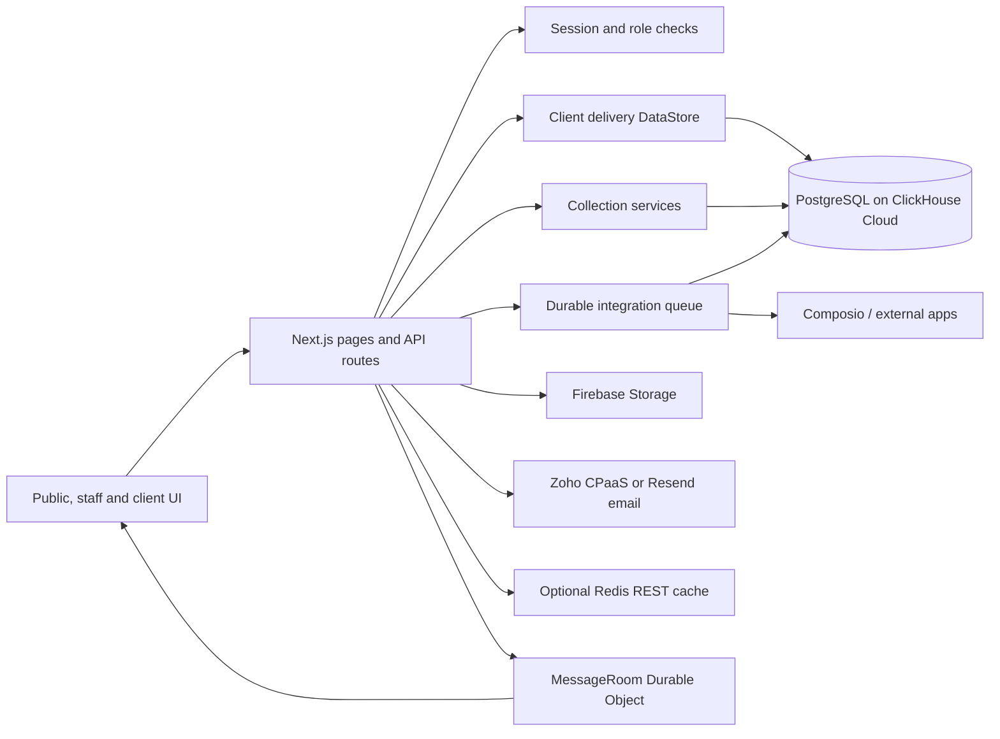

# Boatship architecture

Last reviewed: 2026-10-26. Describes repository history plus pending audit remediation in the current working tree.

This folder is the entry point for understanding and changing Boatship. It describes the implementation visible in this repository; it is not a claim that every optional integration is configured or deployed. Read the source files linked below for exact behavior.

## Read in this order

1. [system.md](system.md) — runtime, data, authentication, request flow, and deployment.
2. [features.md](features.md) — what each user-facing and integration area does, with entry points.
3. [status.md](status.md) — completed work, known boundaries, current working tree, and decisions still open.
4. [enterprise-readiness-audit.md](enterprise-readiness-audit.md) — prioritized minimum controls for wider company use and current gaps.

Existing focused references: [Git integration](../docs/git-integration.md), [MCP clients](../docs/mcp-clients.md), [product integration plan](../docs/products-saas-integration-plan.md), [hosted secrets](../docs/cloudflare-secrets.md), [product principles](../PRODUCT.md), and [design record](../DESIGN.md).

The [Client OS record](client-os.md) describes the account/engagement split, migration, access boundaries, and remaining rollout work.

The [account sections and user management plan](accounts-plan.md) proposes personal account sections for administrators, team members, and clients, plus permissions, invitations, client organization administration, recovery, offboarding, and phased verification. Its phase 0 is implemented and recorded in [accounts.md](accounts.md): explicit account status and authorization version, field-level profile writes, hashed single-use credential actions, email claims, account audit events and mail intents, and the sign-in rule shared by cookie, MCP and job paths. Later phases remain plans.

The [interface redesign record](ui-redesign.md) describes the Regatta visual system, shells and navigation introduced on 2026-10-23; tokens and components are in [DESIGN.md](../DESIGN.md).

Audit implementation references: [staff permissions](permissions.md), [document storage and runtime scaling](document-storage.md), [forms and drafts](forms-validation-drafts.md), [durable integration jobs](integration-jobs.md), and [interface changes](interface-audit-remediation.md). The [Firestore port](firestore-port.md) replaced Neon/Prisma on 2026-10-22 and defined the storage interface; the [PostgreSQL store](postgres-store.md) moved all persistence to a ClickHouse Cloud PostgreSQL service behind that interface on 2026-10-23. The database starts empty.

The [audit completion record](audit-remediation.md) maps all ten findings to changes, verification, and remaining release boundaries. The [October 26 audit record](audit-2026-10-26.md) covers the role-based audit of 2026-10-26: access fixes, Hodi approval for connected-app writes, storage retention, interface fixes and release notes.

Operational references: [runbooks](../docs/operations/README.md) for first admin, releases, restore, and incidents; [dependency advisory triage](../docs/dependency-audit.md).

## At a glance

Boatship is a Next.js 16 App Router application with a public marketing home, a staff application, and a client portal. Staff manage onboarding and delivery for clients; clients complete assigned work and communicate in their own workspace. Staff also manage company products separately from client projects. Hodi provides staff assistance and controlled action proposals.

## Repository map

| Path | Responsibility |
| --- | --- |
| `app/page.tsx`, `app/login/` | Public home and sign-in. |
| `app/(admin)/` | Staff pages under URLs such as `/dashboard`, `/clients`, `/products`, and `/hodi`. |
| `app/(client)/portal/` | Client-only pages under `/portal`. |
| `app/api/` | HTTP endpoints; routes authenticate and authorize before calling domain services. |
| `components/admin/`, `components/client/`, `components/shared/`, `components/hodi/` | Application shells and navigation model, shared component kit and theme toggle, messaging, and Hodi UI. |
| `lib/store.ts`, `types/index.ts` | Client delivery domain and its persistence interface. |
| `lib/products.ts`, `types/product.ts` | Product validation, membership, work, and release helpers. |
| `lib/auth.ts`, `lib/session.ts`, `lib/rbac.ts`, `proxy.ts` | Sessions, roles, permissions, and route-level redirects. |
| `lib/accounts.ts`, `lib/account-status.ts` | Account lifecycle, credential actions, email claims, audit and mail intents ([accounts.md](accounts.md)). |
| `lib/hodi-*.ts`, `lib/agent.ts`, `lib/boatship-rag.ts` | Agent context, queue, proposals, communications, and automation reviews. |
| `lib/git-*.ts`, `lib/mcp-*.ts` | Repository evidence, validation, MCP identity and tools. |
| `lib/firestore/`, `lib/google-auth.ts`, `firestore.indexes.json` | Storage interface with the PostgreSQL client (`postgres.ts`, production), the Firestore REST client (fallback and emulator tests), the in-memory test client, service-account auth, and declared Firestore composite indexes. |
| `custom-worker.ts`, `lib/realtime/`, `wrangler*.toml` | Cloudflare Worker and live message room. |
| `scripts/` | User provisioning, Firestore index creation, QA fixture (PostgreSQL scratch table or emulator), and Cloudflare build helpers. |
| `public/reference-home-static/` | Imported marketing reference assets and static material; avoid treating its older customer claims as verified Boatship claims. |

## How to maintain this folder

For each material change, update the affected section here in the same change: describe the new behavior, source of truth, affected routes, permissions, deployment or migration needs, and limitations. Update `status.md` when a planned item becomes implemented or a boundary changes. Keep historical milestones short and factual. Do not copy secrets, private customer data, or generated files into these docs. The persistent instruction in `AGENTS.md` asks future agents to do this.
