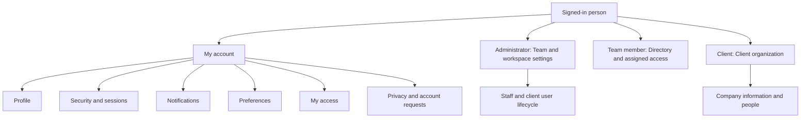

# Account sections and user management plan

Date: 2026-10-23.

Status: **Phase 0 implemented on 2026-10-23** ([accounts.md](accounts.md)); phases 1–4 remain plans. The user confirmed the scope: personal account pages plus user management, permissions, invitations, and account lifecycle for administrators, team members, and clients. The baseline table below describes the repository before phase 0; the implemented record supersedes it for status, profile writes, credential actions, email claims, audit, mail intents and session verification.

## 1. Product decisions and boundaries

Boatship needs one consistent personal account experience, with additional management surfaces appropriate to each role. Keep the existing Regatta design system, staff application, and client portal.

Use these labels consistently:

| Label in the interface | Meaning | Who controls it |
| --- | --- | --- |
| My account | The signed-in person's identity, preferences, security, and access summary. | That person; sensitive changes require identity verification. |
| Team | Boatship staff accounts, invitations, capabilities, and offboarding. | Boatship administrators; team members see a limited directory. |
| Client organization | A client company's shared details and portal users. | Authorized staff; explicitly appointed client administrators in a later phase. |
| Workspace settings | Boatship-wide policies, connections, templates, and operational configuration. | Administrators or the capability required by the existing feature. |
| Product membership | Owner/editor/viewer membership for an internal product. | Administrators manage membership; product roles govern authorized work. |

An administrator still has a personal account. A team member can have no client capabilities and retain personal account access. A client organization can have several people, but each person currently belongs to one client organization.

This plan does not add SaaS billing, subscriptions, invoices, a new tenant system, multiple roles per login, or a workspace switcher. Boatship's Accounting feature is an internal expense ledger, not client billing. SSO, passkeys, and multi-organization membership are separately scoped extensions.

## 2. Repository baseline and gaps

The baseline is the source in this checkout, not an assumption about the hosted deployment. The [PostgreSQL record](postgres-store.md) supersedes older Neon/Prisma and Firestore descriptions for the active storage backend.

| Area | Implemented now | Work required |
| --- | --- | --- |
| Personal account | `/account` and `/portal/account` render the same `AccountSettings` component. Display name, email, role, join date, appearance, password, and session list exist. | Split into focused sections; add role-specific access context, independent loading/errors, and lifecycle controls. |
| Profile updates | `/api/account` accepts only `name` and `digestEnabled`. Email is read-only. | Verified email-change workflow; consistent field validation; safe concurrent field updates. The current hint to ask an administrator does not correspond to an implemented email-edit UI/API. |
| Appearance | System/light/dark, saved in browser localStorage. | Keep honest browser-only wording initially; add timezone and date/time preferences separately. |
| Password | Current password required; change rejects the same password and enforces 8–128 characters. Other database sessions are revoked. Reset/setup uses `/login?reset=...`. | Shared password policy for change/reset/setup, rate limits for sensitive account operations, session rotation, and security event records. Reset currently has an 8-character minimum without the change endpoint's maximum. |
| Sessions | Active database sessions list creation/expiry and whether current; all other sessions can be revoked. | Opaque public IDs, individual revocation, safe device descriptions, and consistent cross-runtime revocation. Public session IDs currently expose the token hash, not the raw token. |
| Authentication | One global role: `admin`, `team`, or `client`; database sessions; a 30-second per-runtime verified-session cache. | Explicit account status, recent-authentication checks, and an authoritative revocation strategy across runtime instances and live sockets. |
| Team management | Staff directory, admin invitations, explicit staff capability editor. | Member detail, invitation tracking/resend/revoke, role changes, suspend/reactivate/deactivate, ownership handover, and audit history. |
| Invitations | Staff invitations last 14 days; client invitations 7 days; forgot-password links 24 hours. One user token field serves both invitation and recovery. | Separate invitation and recovery records, hashed tokens, atomic redemption, delivery state, and retries. Re-inviting an existing same-client user currently clears their password and requires reset; the new flow must avoid that. |
| Client contacts | Directory records have `account_admin`, `contributor`, or `viewer` labels. Those labels grant no application permissions. | Separate contact responsibility from portal access. Add a real portal-user list before introducing client access roles. |
| Client authorization | A client login has one `clientId`; team client access requires current assignment and the relevant staff capability. | Preserve these boundaries; implement any client administrator/viewer behavior across all access paths before exposing role controls. |
| Products | Staff product membership uses owner/editor/viewer, separately from staff capabilities. Administrators have product-wide authority. | Display this separately and include it in handover/offboarding. Do not derive product access from client assignment. |
| Notifications | Per-user in-app inbox; staff digest flag; multiple direct and queued delivery paths. | Per-category/channel preferences and one delivery policy. `/api/account` treats an omitted digest flag as false; digest selection uses `!== false`, so legacy/default behavior needs normalization. No personal digest schedule is established by the checkbox. |
| Connected tools | Existing integrations, encrypted provider secrets, and MCP identity controls. | Link to the existing controls, show ownership safely, and include tokens/connections/jobs in offboarding. |
| Privacy | Staff client-data export and admin client-cascade deletion endpoints exist. | Personal access/export/deactivation requests and a review workflow. Existing client export can include staff-only work; it is not a safe personal download endpoint. |
| Audit | Client activity and MCP audit records exist. | A separate account-security audit that survives client deletion and records staff and personal account changes. |

Primary source references:

- [Shared account UI](../components/shared/AccountSettings.tsx), [account API](../app/api/account/route.ts), [password API](../app/api/account/password/route.ts), [sessions API](../app/api/account/sessions/route.ts).
- [Identity types](../types/index.ts), [authentication](../lib/auth.ts), [session cache](../lib/session-cache.ts), [profile persistence](../lib/store.ts), [staff permissions](permissions.md).
- [Team UI](../app/(admin)/team/page.tsx), [users API](../app/api/users/route.ts), [staff invitation](../app/api/users/invite/route.ts), [client invitation](../app/api/clients/[id]/invite/route.ts).
- [Client account boundaries](client-os.md), [client assignment policy](../lib/client-access-policy.ts), [product roles](../types/product.ts), [MCP authentication](../lib/mcp-auth.ts).
- [Digest sender](../app/api/digests/route.ts), [notifications](../lib/notifications.ts), [client export](../app/api/gdpr/export/route.ts), [client deletion](../app/api/gdpr/delete/route.ts).

## 3. Information architecture

Keep existing root URLs and add subpages. Staff and client pages share section components and schemas, while their layouts and authorized data stay role-aware. Proposed new URLs below do not exist yet.

| Section | Staff URL | Client URL | Primary job |
| --- | --- | --- | --- |
| Profile | `/account` | `/portal/account` | Identify the person and update their name/login email. |
| Security | `/account/security` | `/portal/account/security` | Change password, inspect sessions, revoke access. |
| Notifications | `/account/notifications` | `/portal/account/notifications` | Choose supported work alerts and digest behavior. |
| Preferences | `/account/preferences` | `/portal/account/preferences` | Appearance, timezone, date/time display. |
| My access | `/account/access` | `/portal/account/access` | Understand role, scope, and how to request changes. |
| Privacy | `/account/privacy` | `/portal/account/privacy` | Request personal data or account deactivation and track requests. |

Management routes:

| Surface | Route | Access and behavior |
| --- | --- | --- |
| Staff directory | Existing `/team` | Admin management; limited staff directory for team users. Search, role/status filters, and pagination. |
| Staff member detail | New `/team/[uid]` | Admin-only lifecycle and access editor; tabs for Profile, Access, Assignments, Activity. |
| Staff invitations | New `/team/invitations` | Admin-only pending/expired/revoked/accepted invitations and delivery outcomes. |
| Client people | New `/clients/[id]/people` | Admin or assigned team with appropriate read/manage capabilities; separates directory contacts from portal logins. Link from the existing client detail page. |
| Client organization | New `/portal/organization` | Own-company information. Initially read-only with a correction request; allowlisted edits for explicitly appointed client administrators after phase 3. |
| Client people | New `/portal/organization/people` | Own organization only; client administrators manage portal access after phase 3. Other clients see their own access and designated contacts, not a full identity roster. |
| Workspace security | New `/settings/security` | Admin-only enforced policies when phase 4 ships. No unsupported settings toggles. |
| Existing configuration | `/workspace`, `/integrations`, `/mcp`, `/compliance` | Retain their purpose and server authorization; cross-link rather than duplicate editors. |

Navigation requirements:

- Both shells expose My account from the signed-in identity. Preserve the staff Settings entry and client More entry; client company information is labeled Client organization.
- Desktop account layout: identity summary, a narrow six-item section navigation, and one readable main form column. Mobile: account section list or accessible section selector, then the selected section; retain portal bottom navigation.
- Account links must appear for a team user with `permissions: []`. After sign-in, that user needs an accessible landing state with My account, directory, and any separately authorized products, rather than a dashboard full of denied requests.
- Existing `/account` and `/portal/account` links continue to work. New routes must be covered by `proxy.ts` and current server authorization; client users cannot enter the staff shell.
- Deep links survive sign-in only after a same-origin, role-authorized destination check. Back navigation returns to the originating staff/client context.

## 4. Personal sections for everyone

### 4.1 Profile

Show name/initials, login email, role label, account state, and join date. Use initials as the avatar in the first release; avatar uploads are optional later work with their own upload/retention rules.

- Display name: required, trimmed, 2–100 characters, same validation on server and client. Explain that it appears on messages and work history. Update the shell and current profile immediately after a successful save; historical author names remain historical.
- Login email: read-only until the verified change flow ships. Use accurate help text that points to the available recovery/support path; do not imply an administrator can edit it through an absent feature.
- Email change: show the verified current email and pending new email; verify the new address, notify the previous address, and require recent authentication before confirmation. Keep the current email active until the change commits. Support cancel, expired verification, resend, duplicate address, unavailable mail, and a lost-old-mailbox recovery request.
- Staff-only context: show title/department only if a real team directory requirement is added; they are not required identity fields.
- Client context: show the company as a link to Client organization. Changing a display name or login email never silently edits `Client.name`, `companyName`, or `primaryContactEmail`.
- Role, client association, permissions, account status, and dates are read-only personal fields. Self-service profile PATCH uses a strict field allowlist.

A normal profile save touches only submitted fields. A simultaneous password/permission change must not be overwritten by saving an old whole-user object.

### 4.2 Security and sessions

Sections: Password, Signed-in sessions, Recent security activity. Add MFA only when enrollment, challenge, recovery, and enforcement are implemented.

- Password change requires the current password; use the same supported length/rules as setup and reset. Keep paste, password managers, and show/hide available. Never save a password draft.
- After a successful password change, rotate the current session and revoke all other sessions. Refresh the session list and say exactly what was signed out. Recovery reset revokes every session and returns to sign-in.
- Current session shows a clear Current device label; other sessions have a safe browser/OS summary, sign-in time, expiry, and approximate last-active time only when recorded. Old records display Device details unavailable; never invent device or location data.
- Offer Sign out this session, Revoke this session, and Sign out other sessions. Confirm the broader action with its impact and exclude the current session only when explicitly promised.
- Session endpoints use public opaque identifiers unrelated to token hashes; authorization always binds the target to the current user. Administrators use a separate management endpoint to revoke another user's sessions.
- Security activity shows events such as password changed, email changed, recovery completed, and sessions revoked. Keep this distinct from client task activity.
- Sensitive operations require a recent-authentication proof bound to the current user/session/action, valid for at most 10 minutes. Do not save raw passwords in React persistence, URLs, logs, analytics, or audit records.
- A password-required account with no usable password receives the setup/recovery path. A future SSO-only account receives the identity-provider recovery path, not a broken current-password form.

### 4.3 Notifications

Group controls by work the person actually receives. Only display channels and schedules that have a functioning delivery path.

| Category | Administrators | Team members | Clients |
| --- | --- | --- | --- |
| Messages and mentions | Authorized conversations | Assigned client/product context | Own client-visible conversations |
| Tasks and due dates | Work they are responsible for or follow | Assigned/authorized work | Client-facing work in own organization |
| Documents and forms | Requested review and relevant outcomes | Review capability plus assignment | Own submissions and required actions |
| Approvals | Reviews requiring their decision | Only authorized reviews | Client decisions only when allowed |
| Invitation/access changes | Their own and managed-user events | Their own | Their own; managed-user events for client administrators |
| Digest | Optional authorized summary | Optional assigned-work summary | Deferred until a client-safe digest exists |
| Security/recovery | Required security mail | Required security mail | Required security mail |

- First release: preserve supported in-app behavior and provide an unambiguous staff digest preference. Category/channel controls ship with their delivery enforcement, not ahead of it.
- Distinguish transactional invitation/reset/security mail from optional work alerts. Security notifications are not disabled by work-alert preferences.
- For configurable work channels, offer In-app and Email only where supported. Browser push, SMS, WhatsApp, and Slack notification routing remain hidden until implemented and configured.
- Proposed digest default for new users: off. Preserve existing explicit choices; normalize legacy missing values in a reviewed backfill. The UI must not promise daily/weekly timing until the scheduler and dispatch deduplication exist.
- If a digest schedule is added, persist timezone and frequency, reuse the durable scheduling/job infrastructure, deduplicate by recipient/window, and recheck status/access before dispatch.
- Quiet hours, if added later, defer optional work email; they do not alter deadlines or block security mail.
- Permission loss or client reassignment suppresses future alerts, queued email content, and protected historical links. Preferences do not grant access.

### 4.4 Preferences

- Appearance: System, Light, Dark using existing Regatta tokens and `ThemePicker`. Keep the current browser-only behavior and say so. Cross-device theme sync is a later enhancement with explicit precedence over browser storage.
- Timezone: IANA timezone, detected as a suggested value and saved only after confirmation/save. Store timestamps in UTC. Distinguish timed events from date-only due dates; changing timezone must not shift a date-only deadline.
- Date/time display: locale-aware dates and a 12/24-hour option when applied consistently to account/work views. Show a preview.
- Language: use English initially; do not display an unimplemented language selector. Future localization must include validation, email templates, and accessible names.
- Reduced motion follows the device; layout density and sidebar state remain local interface preferences unless a concrete cross-device need is established.

### 4.5 My access

This is an explanation of effective access, not a self-service permissions editor.

| Role | What appears |
| --- | --- |
| Administrator | Boatship administrator, full current staff capabilities, account state, and links to Team and workspace settings. Explain the effect of administrator privileges. |
| Team | Human-readable capabilities, assigned clients, separate product memberships, and who can change access. Show a clear No client work assigned state. |
| Client | Organization, portal access level when supported, approval ability when applicable, and the account contact/assigned team contact safe to disclose. |

Group staff capabilities as Client work, Reviews, Reporting, and Configuration. Show internal capability keys in an expandable technical detail only when useful. Explain restrictions that a key alone does not convey: assignment is required, `clients.manage` does not imply `clients.view`, some controls require admin role, and products have separate roles.

Connections/MCP appear as links or a small metadata summary for eligible staff. Use the current integration ownership/capability rules. Never show another person's secret, token, provider connection details, or unauthorized client names. An empty capability list can still coexist with an authorized product membership.

Request access opens a persisted request to administrators, with requested capability/client/product and an optional reason. It does not grant access or send an external message unless the product's configured notification path explicitly supports it.

### 4.6 Privacy and account requests

- Show what personal account data can be requested, request state, and a real configured support/escalation path. Do not invent a support address or processing deadline.
- Personal export contains the person's profile/preferences and appropriate personal security history. Shared project records require a separate authorized organization-data workflow; exclude other people's private information, internal notes, credentials, tokens/hashes, connection secrets, and unrelated client work.
- Client organization export is separately reviewed and uses client-visible serialization. Do not expose the current staff GDPR export directly to a portal user.
- Deactivation request stops personal login after an authorized review/handover; it does not delete the client company, completed work, or evidence.
- Personal erasure, organization deletion, audit retention, legal holds, and backups require an explicit retention policy and operator workflow. UI copy describes the implemented request process and makes no unsupported compliance claim.
- Destructive organization actions remain separate admin operations with recent authentication, explicit target confirmation, dependencies, and an auditable result. Do not reuse `/api/gdpr/delete` as a personal Delete my account button.

## 5. Administrator management

### 5.1 Staff directory and member detail

Directory rows: name, email, global role, state, invitation state where relevant, safe last-active time when available, and actions. Search/filter/paginate on the server. Default to active staff; include suspended/deactivated users through filters. Limited team directory responses omit permission lists, security metadata, and lifecycle actions unnecessary for colleagues.

Member detail contains:

1. **Profile:** identity, role, status, joined/invited dates, invitation delivery state. Login email changes still use a verification process.
2. **Access:** effective permissions with labels, role-required restrictions, preset selection with an explicit diff, and a reason for material access changes.
3. **Assignments:** current clients, engagement ownership, open task/milestone responsibility, product roles/ownership, and user-owned integrations/automations.
4. **Activity:** sanitized account changes with actor, time, target, result, and reason. No passwords, verification links, or tokens.

Actions: invite, resend/revoke a pending invitation, change team/admin role, update team capabilities, require password reset, revoke sessions, suspend, reactivate, and deactivate after handover. These are distinct actions with distinct effects.

Recommended permission presets are convenience selections over existing keys, not new global roles:

| Preset | Initial capability selection | Restrictions |
| --- | --- | --- |
| Delivery member | `clients.view`, `clients.manage`, `documents.review`, `forms.review` | Assigned clients only. Existing default users are not silently changed. |
| Read-only delivery | `clients.view` | Assigned clients only; no work mutations. |
| Document reviewer | `documents.review` | Assigned-client document endpoints; a review inbox/link is needed if general workspace view is absent. |
| Form reviewer | `forms.review` | Assigned-client form endpoints; same navigation consideration. |
| Reporting | `analytics.view` | Preserve the analytics endpoint's actual data scope; broader reporting is an explicit admin grant. |
| Custom | Explicit selected array, including `[]` | No inference from job title or another preset. |

Keep the existing omitted-versus-empty semantics. Selecting a preset previews exactly what it adds/removes. `team.manage` does not make a team user an administrator or unlock `/api/users` mutations; it currently also participates in manager approval review. `templates.manage` and `webhooks.manage` remain admin-gated. An administrator's full access cannot be reduced by editing a cosmetic permission array; change role through the role workflow.

### 5.2 Invitation console

Create an invitation from name/email, staff role or client destination, explicit capability/access selection, and optional intended assignments. Preview the recipient, organization, role, and access before sending. Elevated admin invitations require recent authentication.

Track separate states for invitation and delivery:

- Invitation: pending, accepted, expired, revoked.
- Delivery: queued, provider accepted, failed; delivered/bounced only if the configured provider supplies trustworthy receipts.
- Provider acceptance is displayed as Sent, not proof the person received or read the message.

Persist the invitation and a durable mail intent before delivery. Email is sent outside the transaction; a retry uses the same logical invitation without making duplicate users. Resend creates a new token version and invalidates previous links after the replacement is committed. Revocation blocks redemption even if an old email arrives later. Never return raw invitation/reset tokens in list or management responses.

### 5.3 Roles, suspension, and handover

- Promotion/demotion requires current administrator authorization, recent authentication, an impact preview, an atomic last-admin check, and a security audit event. No team/client user can promote themselves.
- Preserve at least one active administrator with usable verified credentials. Pending invitees, suspended users, and reset-only unusable accounts do not satisfy the safeguard. Concurrent changes must not remove the last usable administrator.
- Self-demotion/deactivation requires another usable active administrator. The first-admin provisioning runbook remains the controlled bootstrap/recovery path; do not add public registration to solve lockout.
- Suspension is immediate access denial with preserved history; an urgent suspension must be possible even before handover finishes. Unassigned work becomes a visible administrative exception, not silently transferred to the actor.
- Deactivation requires a handover disposition for client assignment, engagement/task ownership, product owner/editor work, reminders/automations, and provider connections. Transfers validate the replacement person's role, state, capabilities, and domain scope.
- Reactivation is explicit and does not resurrect revoked sessions, tokens, invitations, or connections. Show/review any retained permissions before the user returns.

## 6. Team member experience

Team members receive all personal sections, a limited colleague directory, their effective access summary, assigned clients, and separately authorized products. They can request changes and view their own request outcomes.

- Team members do not invite/manage staff even if a checkbox named `team.manage` is present; preserve existing role checks.
- An assigned team member with `clients.manage` can manage authorized client invitations through the staff client workspace. They cannot move a login to another company, reassign the client owner, or turn a client into staff.
- A team member without `clients.view` still needs a useful account page and any authorized review/product entry points. The account UI must not unconditionally load the general client list/dashboard to render personal settings.
- Own connections and MCP controls remain subject to their existing domain rules. Account visibility alone never authorizes connecting a provider or executing a tool.
- Access-denied views explain the missing scope safely and link to Request access. They must not reveal the existence, name, or activity of an unauthorized client.

## 7. Client organization and portal people

### 7.1 Company information

Show company display name, primary business contact, assigned delivery contact, and available engagements. Keep client record ID, internal tags/notes, risk scores, staff permission configuration, provider credentials, and internal pipeline controls out of the portal.

Initially, all clients read company information and can submit a correction request. After client access roles are enforced, a client administrator may edit an explicit allowlist such as company display name and nominated business contact; reassigning staff or altering lifecycle/internal fields remains staff-only. Changing the primary business contact must not transfer portal administration or change a person's login email.

### 7.2 Real client access roles, proposed for phase 3

Keep `UserRole = "client"`. Add an independent portal access level on the client's user profile while one-client-per-login remains the rule. Use a name such as `clientAccessRole` with `client_admin`, `contributor`, and `viewer`; this is distinct from `ClientContact.role`.

| Client access level | Read client-visible work | Submit tasks/forms/files and messages | Manage company details and portal people | Decide approvals |
| --- | --- | --- | --- | --- |
| Client administrator | Yes, own organization | Yes, subject to work state | Own organization; explicit allowlists and last-client-admin safeguard | Only when explicitly allowed |
| Contributor | Yes, own organization | Yes, subject to work state | No | Only when explicitly allowed |
| Viewer | Yes, own organization | No | No | No |

Represent approval authority explicitly, for example `clientCanApprove`; do not assume company administration is approval authority. Existing client users retain their current contribution/approval entitlement through an explicit migration. Do not convert a contact-directory `account_admin` label into portal administration. An operator must appoint the first real client administrator.

This is an actual behavior change. Centralize and test the client policy across tasks, comments, form submit/review paths, uploads/replacement, document reads/history, messages/live tickets, project operations/approvals, engagement reads, notifications, search, exports, and any future client tools. A viewer can read shared messages but cannot post. Internal tasks/notes stay hidden for every client access level. Closed engagements keep their existing historical-read/write restrictions. Do not advertise Viewer before every mutation path denies viewer writes.

### 7.3 People management

For each person, distinguish Contact only, Invited, Active, Suspended, and Deactivated. A directory contact may be linked to a login explicitly; changing/deleting the directory entry never grants/revokes login as a side effect.

- A staff client-people page lists contacts and portal users separately with clear links between them, if any.
- Only a real client administrator sees the full portal-user roster and client invitation/lifecycle controls in the portal. Other clients see their own access and approved business contacts.
- Client administrators can invite contributors/viewers, change authorized client access levels, and revoke access only inside their organization. Promoting another client administrator requires recent authentication and an explicit privilege confirmation; it never creates Boatship staff.
- Preserve one usable active client administrator once one has been appointed. Staff administrators can recover management after all client administrators lose access. Before appointment, staff remain the managers and the portal does not imply a client admin exists.
- An email already used by staff or another client organization cannot be reassigned by invitation. Show a safe conflict to the authorized manager; use a separately planned membership model for future multi-company access.
- Do not reset credentials when re-inviting an active client user. Offer Send sign-in instructions or the ordinary recovery path, preserving the password and current account state.
- Requesting departure from the company does not delete shared documents, submissions, messages, engagements, or company data.

## 8. Permission and authorization contract

| Operation | Administrator | Team | Client administrator, proposed | Contributor/client today | Viewer, proposed |
| --- | --- | --- | --- | --- | --- |
| Read/update own allowed profile/preferences | Yes | Yes, including no capabilities | Yes | Yes | Yes |
| Change own password/revoke own sessions | Yes | Yes | Yes | Yes | Yes |
| Change own global role/client association | No self-service | No | No | No | No |
| Manage staff accounts | Yes, with safeguards | No | No | No | No |
| Read a client organization | All | Current assignment + read capability | Own | Own | Own |
| Invite/manage client portal users | Yes | Current assignment + management capability; constrained actions | Own organization after phase 3 | No | No |
| Assign a client to staff | Yes | No | No | No | No |
| Manage product membership | Yes, under existing product rules | No; even a product owner cannot use the admin-only membership API | No | No | No |
| Run integrations/MCP | Existing capability, identity, scope, and ownership rules | Same, with team limits | No new client entitlement | No new client entitlement | No new client entitlement |
| Export own account data/request deactivation | Own | Own | Own | Own | Own |
| Export/delete a client organization | Existing staff export/admin deletion authorization; separate review | Export only with required capability + assignment | Request only | Request only | Personal request only |

Additional invariants:

1. APIs and domain services authorize from authoritative identity and domain records; shell visibility and unsigned token routing hints are not permission checks.
2. New endpoint families are explicitly added to the staff policy registry or enforce their domain policy directly. `requireSession` by itself is not authorization for user management.
3. Self endpoints derive `uid` from the session and reject body/query attempts to substitute a user, role, company, status, or permissions. Client management resolves company from the session/current target and compares both.
4. Ownership and authorization are rechecked at execution for queued jobs, Hodi proposals, manager approvals, and MCP tools. Suspension/deactivation blocks all these paths, not only browser login.
5. Current session caching can allow other runtime instances to retain verified identity for up to 30 seconds. Before promising immediate revocation, add a shared authoritative status/authz-version check to protected requests and live-message delivery. A local cache purge alone is insufficient.
6. Live sockets need server-side revocation/expiry enforcement. A one-minute connection ticket checked only at upgrade does not terminate an already-open socket. Close affected sockets and reauthorize delivery; define and test the propagation bound.
7. Proposed access-removal contract: deny protected requests and new live delivery after the authoritative removal commits; a request already authorized/in flight may complete. Mutations recheck authority inside their commit boundary where feasible. Any weaker measured propagation bound must be documented and reflected in UI copy before release.
8. Personal data and role-sensitive management responses use private/no-store behavior. Shared caches cannot reuse another person's account data or continue serving a roster after access changes.

## 9. Account and invitation lifecycle

Store account state separately from invitation state and password-reset state. `mustResetPassword` is not an account suspension flag.

| Account state | Entry | Sign-in | Exit |
| --- | --- | --- | --- |
| Invited | New account prepared for setup | No ordinary session before setup completes | Atomic invite acceptance to Active; revoked/expired invite remains unable to sign in. |
| Active | Setup/verified activation completed | Yes, subject to credential and policy checks | Suspend or deactivate. |
| Suspended | Authorized immediate access block | No; deny existing sessions/tools/jobs/sockets | Explicit reactivation; existing revoked credentials stay revoked. |
| Deactivated | Offboarding completed or removal finalized | No | Administrator-controlled restoration, with access reviewed; erasure is a separate process. |

Critical flows:

1. **New staff member:** admin selects role/capabilities → invitation/durable mail intent committed → recipient opens valid setup link → token and status checked → password set and token consumed atomically → sign in → role-safe landing → profile/access confirmation.
2. **New client user:** authorized manager chooses own/assigned company and portal access → invitation → setup → portal-only landing → company/access summary and next client-facing task. Directory contact creation remains optional and explicit.
3. **Password recovery:** generic request outcome protects account existence → separate short-lived hashed reset token → one successful redemption → password update and session revocation → fresh sign-in. A reset never reactivates a suspended/deactivated account.
4. **Email change:** recent auth → normalized new-address claim → verification mail → atomic confirmation/unique-email claim update → notify old address → revoke old sessions and require sign-in with the new address. Pending/cancelled changes keep the original login usable.
5. **Permission/assignment change:** authorized manager previews impact → versioned write/audit → invalidate relevant authorization → refresh access summary → deny stale API/tool/job/socket access. Do not grant product membership from client assignment.
6. **Urgent suspension:** current authorization and reason → status/authorization version committed → deny auth and tool execution → revoke sessions/tokens and close sockets → retain data → show handover work still required.
7. **Planned offboarding:** preview owned work/dependencies → validate replacement people → commit or durably track transfers → deactivate identity → revoke sessions, tokens, outstanding links, and pending actions → disconnect/reassign provider resources explicitly → preserve audit/authorship.
8. **Reactivation:** admin reviews retained access → activate with current policy → issue a fresh setup/recovery flow if needed → audit. No previous session/token is restored.

Invitation/password setup links have explicit invalid, expired, revoked, already-used, and failed-delivery states with a safe retry route. Concurrent redemptions elect one winner. A failed email must not leave the interface claiming success or erase an existing user's credentials.

## 10. Data and service design

Use the existing collection abstraction backed by PostgreSQL JSON documents. Current persistence does not use Prisma or SQL schema migrations; record-shape changes need versioned, guarded application backfills and compatibility rules. Retain the Firestore/in-memory contract where the repository still tests it.

| Record/service | Planned responsibility | Compatibility rule |
| --- | --- | --- |
| `UserProfile` additions | `status`, `updatedAt`, `authzVersion`, optional `emailVerifiedAt`, `clientAccessRole`, `clientCanApprove`, suspension/deactivation metadata. | Update `AppUser`, profile codecs, local demo, QA fixtures, scripts, and both read/write paths; new fields must survive serialization. Never infer verification/privilege from contact labels. |
| `UserPreference` | Versioned timezone/date/time and notification preferences, including explicit defaults. | Bridge the existing `digestEnabled` flag until all senders use the new policy. Theme remains browser-local initially. |
| `AuthSession` additions | Independent public ID, issued authz/session version, rotated-session handling, recent-auth state, safe device summary, throttled last-active timestamp. | Existing creation/expiry records remain readable; do not persist raw bearer tokens. |
| `Invitation` | Target user/company, intended role/access, token hash/version/expiry, inviter, state, accepted/revoked timestamps, mail intent linkage. | Replace the overloaded invite/reset field; retain old links only through an explicit, bounded migration path. |
| `CredentialAction` | Separate hashed reset, email verification/change, and recent-auth proofs with purpose/session/expiry/consumed state. | A token for one purpose cannot be accepted for another. Redemption uses a transaction/precondition. |
| `IdentityEmailClaim` | Unique normalized login address claim; pending-change reservation/expiry; user association. | The JSON table does not currently provide a global unique email constraint. Prevent concurrent invitations/changes from creating duplicate identities through transactional claims. |
| `AccountAuditEvent` | Append-only sanitized actor/target/action/result/reason and correlation ID. | Separate from deletable client activity; audited administration commits with its authoritative account change. |
| `AccountRequest` | Access, company correction, export, recovery escalation, and deactivation request state/decision. | Personal and organization request scopes are explicit; no automatic broad export/deletion. |
| `AccountMailIntent` or equivalent durable job | Invitation, verification, security notice, optional digest delivery with dedup/retry. | Reuse queue primitives if appropriate; existing integration jobs do not imply transactional account mail already exists. |
| Account domain service | Safe partial updates, uniqueness, lifecycle transitions, last-admin checks, authz invalidation, and audit writes. | New critical paths use transactions rather than whole-object read/modify/upsert. |

Transaction boundaries:

- Atomically claim email + create identity/invitation + audit + mail intent where possible within the existing database. Provider delivery happens afterward and is retried idempotently.
- Atomically validate and consume a setup/reset/email token with the corresponding account update. A read followed by a generic upsert does not guarantee single use.
- Atomically verify usable-admin counts and role/state changes. Concurrent admin demotions or deactivations cannot both pass an earlier count.
- `UserProfile` is authoritative today; snapshot user synchronization is best effort. Never rely on a successful legacy sync as proof a cross-collection security change is atomic. Preserve that source of truth during migration.
- Staff assignments and client work remain partly in `StoreSnapshot`; product/identity records use separate collections. Handover across these boundaries needs a versioned plan/progress record, retry-safe steps, and visible partial completion. Suspend first for urgent removals.
- Security flags, credentials, permissions, and client roles must not be overwritten by concurrent profile/digest saves. Enforce field-level updates with preconditions and expected versions.
- Backfills inventory duplicate emails, omitted permissions, existing reset links, legacy digest values, and client entitlements. Stop/report ambiguous records rather than guessing permissions or erasing active credentials.

## 11. API work map

Endpoint names below are proposed contracts. Keep current responses working until their callers migrate; use structured validation, rate limits, consistent errors, and role/domain checks for every added method.

| Endpoint | Plan |
| --- | --- |
| Existing `/api/account` GET/PATCH | Safe own-account DTO and strict name/profile allowlist. Add version/precondition handling; move preference writes behind their own schema without abruptly breaking digest callers. |
| Existing `/api/account/password` POST | Shared password policy, sensitive-action throttling, atomic credential update/session epoch, current-session rotation, and audit. |
| Existing `/api/account/sessions` GET/DELETE | Opaque IDs and truthful metadata; preserve revoke-others compatibility while UI migrates. |
| New `/api/account/sessions/[id]` DELETE | Revoke one own session; current-session deletion signs the person out. |
| New `/api/account/preferences` GET/PATCH | Versioned own preferences, allowlisted timezone/date/time fields and supported notification settings. |
| New `/api/account/access` GET | Effective personal role/capabilities/domain scopes with safe pagination/links. No general client-list requirement. |
| New `/api/account/reauth` POST | Short-lived proof for sensitive actions; rate-limited and session/action-bound. |
| New `/api/account/email-change` POST/DELETE | Create/cancel pending email change; separate confirmation contract through credential actions. |
| New `/api/account/security-events` GET | Paginated sanitized own security activity. |
| New `/api/account/requests` GET/POST | Create/list own access/privacy/deactivation requests and results. No arbitrary target user or client data access. |
| Existing `/api/users` and new `/api/users/[uid]` | Preserve current staff-directory/permissions behavior; add admin detail DTOs and separate allowlisted management mutations. Limited team DTO is narrower than admin DTO. |
| New `/api/users/[uid]/lifecycle` POST | Explicit suspend/reactivate/deactivate/role-change operation with version, reason, recent auth, safeguards, and handover reference. |
| New `/api/users/[uid]/sessions` DELETE | Admin revocation of another user's sessions; audit and target confirmation. |
| Existing invite endpoints + new invitation management | Shared domain service; list/resend/revoke invitation records under admin or same-client authorization. Never reuse active-user invitation as password reset. |
| New `/api/clients/[id]/portal-users` GET/POST | Staff authorized roster/invite; client-admin own-company branch only after phase 3 policy enforcement. |
| New `/api/clients/[id]/portal-users/[uid]` PATCH | Same-company client access/lifecycle actions, allowed role transitions, last-client-admin protection, no global role/client reassignment. |
| New `/api/account/organization` GET/PATCH | Own client-safe company DTO; read-only initially, allowlisted client-admin changes in phase 3. |
| New account-request review API | Admin list/review of scoped access/privacy requests; grant/deactivate/export through existing authorized domain services, not request status alone. |
| New workspace-security policy API | Phase 4 admin-only actual enforcement settings; never use display-only policy flags. |

Unauthenticated verification/setup/reset endpoints must accept only their specific purpose-bound token, avoid account enumeration, and permit safe password-manager/browser behavior. Keep cookie mutation origin protections and private/no-store responses. Error responses should distinguish validation, permission, authentication, version conflict, rate limit, and unavailable mail without leaking sensitive records.

## 12. Interface behavior and accessibility

- Preserve Regatta typography, tokens, both themes, shared form controls, and reduced-motion behavior. Use clear section headings and flat form groups; no new visual identity is needed.
- Profile is the entry section. Security and access have direct links; optional preferences do not hide recovery or sign-out controls.
- Each section loads/saves independently. A session-list failure cannot make name editing unavailable, as the current shared `Promise.all` loading can do.
- One Save changes action per editable group; disabled until dirty and valid. Show saving, saved, inline errors, and actionable retry. Preserve input on network failure; prevent duplicate submissions.
- Warn before discarding unsaved non-secret edits. Clear personal drafts and caches on identity changes; passwords/tokens/reauth proofs never enter browser draft storage.
- Use labels, autocomplete attributes, associated field errors, visible keyboard focus, correct navigation semantics, and announced status/error messages. Focus the first invalid field; return focus after a modal closes.
- At least 44px touch targets; no clipped account navigation, obscured actions behind the portal tab bar, color-only permission/status information, or horizontal page scrolling at 320px.
- Confirm dialogs state the actual person/company, operation, and consequences. Reversible preference saves need no confirmation. High-impact role changes, broad revocation, offboarding, and deletion have explicit review states.
- Long names/emails, Unicode names, empty lists, many sessions, many clients/products, expired links, stale tabs, and screen zoom are expected states. Use wrapping/truncation with accessible full values and pagination where appropriate.
- Show unavailable/failed data honestly. A failed session revoke does not remove the row optimistically without recovery; partial handover is visible, and provider acceptance is not labeled Delivered.
- No impersonation, view-as-client, public registration, or client organization switcher is added by this plan.

## 13. Delivery phases and dependencies

Each phase includes its behavior/API, data changes, UI, verification, documentation, and release evidence. Nothing below is marked implemented by this plan.

| Phase | Deliverables | Exit criteria |
| --- | --- | --- |
| 0 — Account foundations (implemented 2026-10-23, [accounts.md](accounts.md)) | Account DTO/policy schemas, safe partial writes, explicit status, email claims, separate hashed credential actions, audit/mail intent records, cross-runtime invalidation design and tests. Inventory/backfill plan and legacy compatibility. | Credentials cannot be overwritten by preference saves; duplicate email/token redemption races fail safely; suspension policy works beyond one runtime. Met in unit tests; hosted verification pending. |
| 1 — Personal accounts | Shared six-section account layout in both shells; existing profile/password/session/theme features migrated; opaque individual sessions; role-aware access summaries; accurate digest UI; account requests; supported timezone/date display. Verified email change ships only with phase 0 controls. | Admin, normal/zero-capability team, and current client can use every supported personal flow; recovery and session rotation work; unsupported controls stay hidden. |
| 2 — Staff administration and client roster | Staff directory/detail/invitation console; role changes; suspend/reactivate/deactivate; last-admin safety; handover; staff-managed client portal roster; read-only client organization/correction requests. | Full invite → accept → scoped work → access change → offboard story passes; existing active-client reinvite cannot reset credentials. |
| 3 — Client administration | Real client access roles/approval entitlement; nominated initial client admin; own-company people and allowlisted company editing; viewer policy across all resource paths; last-client-admin recovery. | Client admin/contributor/viewer behavior is enforced server-side everywhere, and cross-company isolation passes. |
| 4 — Security and delivery extensions | MFA enrollment/challenge/recovery and admin policy, real per-category notification delivery, scheduled digests/quiet hours if required, and approved privacy/export fulfillment. SSO/passkeys need a separate provider decision. | Enforced policies, delivery/recovery tests, observability, and hosted verification match UI claims. |

Dependency order: phase 0 before sensitive personal changes; phase 2 before delegated client administration; phase 3 server policy before any client role picker. UI-only profile/navigation work can be developed alongside phase 0 but cannot ship sensitive controls ahead of it. MFA/provider choices do not block drafting/building the core personal sections, but wider privileged-account rollout should include an explicit MFA decision.

Implementation touchpoints:

- Reuse account section components under `components/shared/`; add small staff/client route wrappers and account section layouts rather than three independent account implementations.
- Update `AuthProvider`, both shells, navigation/command-palette entries, and role-safe login destinations together.
- Update `types/index.ts`, profile codecs in `lib/store.ts`, `lib/auth.ts`, session cache, staff/client policies, MCP, Hodi execution, job authority checks, notification senders, and realtime revocation paths for account state/access changes.
- Inspect installed Next guides under `node_modules/next/dist/docs/` before implementation; planning consulted the local layouts/pages, Route Handlers, and Proxy guides. Keep `proxy.ts` as coarse routing/origin protection and authorize at the data/API boundary.
- Update [permissions.md](permissions.md), [client-os.md](client-os.md), [system.md](system.md), [features.md](features.md), and [status.md](status.md) in the material implementation changes. Correct stale baseline descriptions only with verified source evidence.

## 14. Verification and release acceptance

Use synthetic identities across two client organizations and two products. Include two active admins, an invited admin, a team user with default permissions, explicit `[]`, a review-only user, an assigned/unassigned team pair, current client users, and phase 3 client-admin/contributor/viewer users.

| Scenario | Required proof |
| --- | --- |
| Own account | All roles can read/edit only allowed personal fields; arbitrary UID/role/client/status/permission injection is denied; failures in sessions do not block profile. |
| Concurrency | Name/digest saves cannot revert password/status/capabilities; two email claims have one owner; two token redemptions have one winner; last-admin races cannot lock out the workspace. |
| Password/session | Shared setup/reset/change policy; incorrect/current password and throttling; rotation; individual/current/other-session revocation; reset invalidates all old sessions; public DTOs contain no token hashes. |
| Authentication state | Invited/suspended/deactivated users cannot authenticate; reset cannot reactivate them; reactivation restores no old sessions/tokens; role-safe redirects do not loop on stale token hints. |
| Cross-runtime removal | Warm verified sessions on multiple runtime instances, revoke/change status/access elsewhere, then confirm API, MCP, Hodi, pending jobs, and existing sockets respect the declared removal contract. |
| Invitations | Accepted/expired/revoked/reused states; resend invalidates prior version; provider failure/retry is truthful; duplicate-email and wrong-company conflicts; active-client reinvite preserves credentials. |
| Staff boundaries | Team cannot manage staff; defaults vs `[]`; read/manage independence; assignment changes remove access; review-only accounts retain authorized resource entry points; product roles stay separate. |
| Client boundaries | Company A cannot enumerate/manage Company B; contact role edits do not change login privileges; internal work stays hidden; phase 3 viewers cannot write through any alternate endpoint. |
| Approval and history | Explicit client approval authority is enforced; closed-engagement history remains readable while prohibited work mutations fail. |
| Offboarding | Urgent suspension denies access before handover; retry-safe transfers preserve work; product ownership and integrations are resolved; historical authorship/audit remain; last-client-admin protection works. |
| Notifications | Preferences and account status apply to every supported delivery path; required security mail remains; digests contain only current authorized context; scheduling is timezone-aware and deduplicated. |
| Privacy | Personal export excludes credentials/internal/unrelated/third-party private data; requests do not run client cascade deletion; audit retention and partial export/deletion failures are explicit. |
| Responsive/accessibility | Keyboard-only, focus/errors/live feedback, password manager, reduced motion, both themes, 320px mobile, desktop, zoom, long identity strings, and many memberships/sessions. |

Run meaningful policy/domain tests and isolated HTTP flows, then repository unit suite, typecheck, lint, Next build, Cloudflare build/dry-run for material runtime changes. Use PostgreSQL scratch tables or the established emulator harness; never test destructive account changes against real users. Browser QA covers desktop/mobile together and one bounded repair pass.

Before release: inventory/back up identity data, dry-run guarded backfills, verify readable old/new records, establish rollback compatibility, verify provider configuration by capability/name without exposing values, and exercise the complete authenticated journey on the hosted Worker with synthetic users. A successful local build or anonymous health check is not proof account management or real mail works.

Observe invitation failure/acceptance, reset failure/rate limits, denied management requests, revocation propagation, handover failures, and optional mail queue delay through sanitized logs/metrics. No tokens, passwords, email verification URLs, raw IPs, or private document content enter routine telemetry.

## 15. Defaults and decisions before implementation

The confirmed scope and recommended defaults are sufficient to begin core implementation; the remaining choices attach to the features they affect rather than blocking the entire account system.

| Decision | Recommended planning default | Needed before |
| --- | --- | --- |
| Global roles and client membership | Preserve admin/team/client and one client per login. | Core implementation; no new tenancy assumed. |
| Visual authority | Existing Regatta system and shared controls. | Personal account UI. |
| Avatar | Initials; no required image upload. | Profile UI. |
| Notifications | Preserve explicit existing choices; new-user digest off; hide unsupported delivery/schedule controls. | Preference backfill and UI. |
| Client administration | Staff-managed first; appoint client admins explicitly; directory labels never become permissions automatically. | Phase 3 migration/rollout. |
| Existing client write/approval rights | Preserve explicitly during migration, then let authorized managers review. | Phase 3 policy activation. |
| Invitation expiration | Preserve existing 14-day staff / 7-day client behavior initially, with server-configured policy and no lifetime increase by accident. | New invitation service. |
| Recovery expiry | Preserve existing 24-hour recovery behavior initially; separate token purposes and shared password validation. | Credential-action migration. |
| Administrator ownership | Keep admin role; protect last usable admin; no new owner/super-admin role. | Staff lifecycle actions. |
| Security removal semantics | Authoritative request/delivery checks after removal commit; explicitly test in-flight/cross-runtime limits. | Suspension/revocation release. |
| MFA/SSO/passkeys | Implement full MFA only with a tested method/recovery policy; choose SSO/passkey support separately. | Phase 4 and wider privileged rollout. |
| Support and privacy operations | Configure a real escalation destination, reviewer, retention/export rules, and request status workflow. | User-facing request fulfillment. |
| Plans and billing | No invented pricing, subscription management, or client invoices. | Separate commercial product decision. |

Definition of completion for the account program: each role has a usable personal account; managers can invite, understand, change, and end access safely; client organization controls respect actual portal permissions; recovery and handover preserve shared work; all advertised actions have implemented server behavior and verified hosted evidence.
