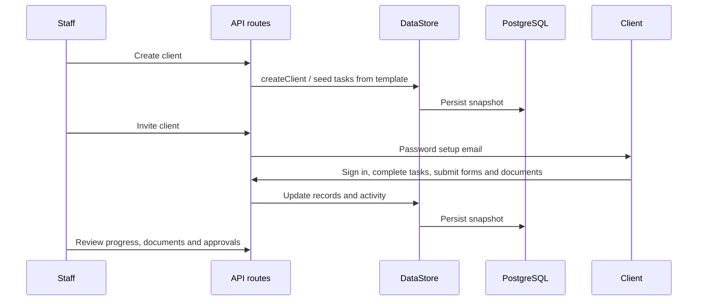

# System design and request flow

Last reviewed: 2026-10-23. October audit changes and the PostgreSQL read-path caching are implemented locally and await deployment.

## Runtime and entry points

- Next.js `16.4.1`, React 19, TypeScript, Tailwind CSS. Pages use the App Router. Staff and portal route groups have separate shell components; their group names do not appear in URLs.
- `proxy.ts` handles coarse browser routing: the public home stays accessible; unauthenticated protected page visits go to `/login`; client and staff pages redirect to the correct home. API routes do their own database-backed session and permission checks. The proxy's decoded token payload is not the final authorization decision.
- `app/api/**/route.ts` contains HTTP handlers. `lib/api.ts` standardizes success/error responses. Most handlers declare the Node.js runtime; the Cloudflare adapter packages them for Workers.
- The public Cloudflare Worker forwards ordinary HTTP and scheduled Next.js requests to four bounded `AppRuntime` Durable Object instances. `lib/runtime-routing.ts` hashes the session cookie/bearer header, or an anonymous route key, into `app-0` through `app-3`; raw credentials are never instance names. The Durable Object runs the OpenNext handler outside the public Free-plan invocation's CPU ceiling. The existing `MessageRoom` still handles live sockets. Each instance keeps the raw snapshot slices keyed by the meta version ([postgres-store.md](postgres-store.md), read path), so a request normally costs one meta read; database conditional writes coordinate instances. The existing `v2` class migration and binding are reused; no additional Durable Object migration is needed. Sharding is implemented locally and needs hosted traffic measurement.
- `app/layout.tsx`, `app/globals.css`, the two route-group layouts, and `components/*Shell.tsx` define the global UI frame. `components/shared/AuthProvider.tsx` manages browser auth state.

## Persistence

**Primary database:** a PostgreSQL service on ClickHouse Cloud, selected by `DATABASE_URL` and reached through `lib/firestore/postgres.ts` (postgres.js over TLS). Every collection is a set of JSON documents in one `documents` table; see [postgres-store.md](postgres-store.md) for the mapping, transactions, and limits. The same storage interface is also implemented by the Firestore REST client (`FIREBASE_SERVICE_ACCOUNT`, kept as a fallback; `FIRESTORE_EMULATOR_HOST` for emulator tests) and an in-memory client for unit tests. `ALLOW_LOCAL_STORE=1` keeps the file-based demo. [firestore-port.md](firestore-port.md) records the collection names, document ids, and transaction rules every module follows.

**Client delivery store:** `lib/store.ts` exposes `DataStore`. Client metadata, tasks, templates, document metadata, form templates/submissions, activity, comments, messages, webhooks, smart lists, agent chat history, vessels, integration runs, and project operations remain in a `StoreSnapshot` JSON record. `FirestoreStore` reads the meta version before each mutation (reusing the instance's cached slices when the version is unchanged) and conditionally commits every changed slice plus the meta version in one database transaction, retrying conflicting writes. `handleApi` and binary retrieval create an AsyncLocalStorage scope; one request can reuse its parsed store, while subsequent requests parse a fresh copy from the instance's slice cache and refetch only slices written since. Successful writes refresh that request's snapshot and advance optional Redis generation. Concurrent document replacements append the actual current file inside the retry; native form submission commits answers, identity, activity, and webhook intent together. The whole metadata snapshot remains a write-contention constraint. Explicit demo mode retains `.data/store.json`; fixed demo users are seeded only there.

**Collections:** `AuthSession`, `UserProfile`, and `NotificationRecord` support hot identity and notification reads. `RateLimitBucket` stores shared quotas; the `StoreSnapshot` meta document carries the version while each slice is its own document. `DocumentContent` owns each file and stores small bytes inline or, when the Firebase Storage secrets are present, an `objectKey` into Firebase Storage ([document storage](document-storage.md)). `IntegrationJob` stores leased provider work. Other collections hold provider secrets/connections, MCP, Git, Hodi, and product work; each ported module exports its `Doc` type and `Collection`.

**Client OS split:** `Engagement` and `ClientContact` are their own collections. `Client` remains in `StoreSnapshot`; its old status and pipeline fields remain the original onboarding state. New tasks can carry an engagement ID in the snapshot, while old tasks resolve to a deterministic legacy onboarding engagement. Contact directory roles do not grant application access. See [client-os.md](client-os.md) for migration and route boundaries.

**Write boundary:** Multi-document writes that must commit together (snapshot mutations, queue claims, proposal state changes, product ownership, MCP token issuance) run as read-write transactions (serializable on PostgreSQL) and retry on contention. Cross-collection cascades are chunked commits ordered so a crash leaves orphans rather than dangling references. Snapshot slices are capped at 900 KB of JSON so the Firestore fallback, whose documents hold at most 1 MiB, keeps working.

**Optional cache:** `lib/redis-cache.ts` uses Upstash-compatible Redis REST for selected read endpoints. It is best effort and keyed by a generation advanced after datastore writes. Redis failure falls back to the database. Do not assume it invalidates independent relational product writes; those queries have their own behavior.

**Documents:** `app/api/documents/upload-url` returns a logical client-scoped database path. `/api/documents/upload` validates strict base64, a 10 MiB limit, filename, extension, MIME, signature, ownership, task, and open engagement before saving a separate `DocumentContent` byte record and retrying its metadata commit. All metadata responses omit bytes and internal content IDs. Authenticated `GET /api/documents/[id]/content` retrieves current or zero-based historical content, with private/no-store headers and byte-range support. Metadata-only POST and PATCH file replacement are rejected so they cannot bypass upload validation. Preview/download/replacement use this flow. Files live in Firebase Storage when configured. See [document-storage.md](document-storage.md) for migration and failure boundaries. Malware scanning and retention remain open.

## Identity and authorization

1. `POST /api/auth/login` verifies a stored scrypt password hash and creates a random session token. A hash of the token, user ID, and expiry are stored in `AuthSession`. The browser receives an HTTP-only cookie; bearer tokens are also accepted by API session resolution. Verified sessions are memoised for 30 s per instance (`lib/session-cache.ts`); logout, revocation and user changes clear the affected entries.
2. `lib/auth.ts` verifies the token against the database, checks expiry, reloads the current user, and rejects users required to reset their password or still using known fixed demo credentials in production. `proxy.ts` supplies page redirects based on the token's embedded routing hint and rejects cross-origin cookie-authenticated API mutations. API routes remain responsible for authorization.
3. API session resolution applies `lib/rbac.ts` method/area capability policy in addition to route roles and `lib/client-access.ts` ownership checks. Explicit empty staff grants deny capabilities; only omitted grants use defaults. Read, manage, document review, form review, integration, and export capabilities are independent. MCP additionally checks the current token owner's permissions and reset state. Team access remains restricted to current committed client assignment; client users remain scoped to their own account. Product roles remain separate. See [permissions.md](permissions.md).
4. Invitations and password resets use one-time setup/reset links and `lib/email.ts`. Hosted delivery uses the Zoho India CPaaS email API with `ZEPTOMAIL_API_KEY` and a verified general `ZEPTOMAIL_FROM`, or Resend with `RESEND_API_KEY` and `RESEND_FROM`. Zoho takes priority when configured; missing or onboarding-specific sender configuration throws instead of reporting a demo send. The shared mail function selects Boatship, Boatship Team, or Boatship Updates as the display name by message type. Client and team invitations have separate content; task mail uses engagement context. Admins can send a token-free team welcome message for controlled one-time use via the rate-limited `team_welcome` action in `/api/notify`; the Team page has no permanent welcome control. User and account management endpoints are under `/api/users`, `/api/clients/*/invite`, and `/api/account`.
5. User-entered provider secrets are encrypted by `lib/user-secrets.ts` before persistence. `BOATSHIP_SECRETS_MASTER_KEY` must be retained for decryption. MCP tokens are shown once and stored hashed; MCP scopes and project access are verified separately.
6. Login, password reset, invitation, MCP, and agent chat requests consume shared database rate limits in `lib/rate-limit.ts`. Explicit local-only demo mode uses process-local buckets so it can run without a database. Outbound webhooks require a configured exact HTTPS origin in `WEBHOOK_ALLOWED_ORIGINS`; redirects are rejected and list/detail responses redact signing secrets.

Development-only proxy handling recognizes Next's canonical localhost URL when the actual browser Host is another loopback address, while retaining exact Origin, port, and fetch-site checks. Hosted URL-origin validation is unchanged. This permits local cookie-authenticated sign-out/submission at 127.0.0.1 without disabling the CSRF boundary.

## Typical client delivery flow

Task work may carry subtasks, dependencies, comments, evidence, definition-of-done, Git links, validation, and manager approval. Client project operations add milestones, schedules, and approvals through `lib/project-operations.ts`. Notifications and activity connect changes back to staff and clients. Product overdue work and milestones create member-scoped in-app notifications on weekday Worker cron runs, with deterministic IDs preventing duplicate notifications for the same item and day.

The account can contain multiple engagements. Tasks, forms, documents, messages, milestones, and approvals can carry context. Explicit `engagementId=account` selects account-wide resources; a real engagement selects its records, with account-wide inclusion only when requested. Old task-linked files/forms inherit their task's legacy context; unlinked records remain account-wide. Completed/cancelled contexts retain history and reject new uploads, form submissions/reviews, messages, and approval decisions. Portal and intake drafts use scoped 24-hour sessionStorage with honest storage-failure feedback. See [forms-validation-drafts.md](forms-validation-drafts.md) and [interface-audit-remediation.md](interface-audit-remediation.md).

## Hodi creation flow

`/api/agent/chat` gives the model a `propose_boatship_action` tool alongside optional connected-app tools. The proposal tool validates the requested action, checks current staff permissions and client/product access, and stores a short-lived proposal with its payload hash and preview. The chat UI reads the signed-in user's pending proposals and offers Approve or Decline. Approval sends the original payload and single-use token to `/api/agent/actions/execute`; `lib/hodi-actions.ts` claims the proposal atomically, revalidates it, then dispatches to the relevant domain creation module. This path also supports existing direct proposal APIs. A successful action returns its created record and, where applicable, a page link. Calendar creation calls Google Calendar through the signed-in user's Composio connection. The UI offers Continue plan after execution and supplies created record IDs to the next chat turn. Each dependent step needs its own proposal; there is no cross-service transaction or automatic scheduling.

## Live messages

`/api/messages` is the persisted source of truth. After save, the route publishes to a client-specific `MessageRoom`. The Worker verifies a short-lived server-issued ticket before socket upgrade. Context is filtered by both HTTP reads and browser realtime/polling state; changing context clears stale results and names the compose destination. The Worker needs `MESSAGE_ROOM` and `MESSAGE_REALTIME_SECRET`; local Next development uses polling when realtime is unavailable.

## Webhook delivery and health

Event routes await webhook intent in the snapshot. Native form submission includes that intent in its domain commit; other writes/enqueues remain separate. Secret-protected drains lease, back off, and stop after ten attempts; receiver delivery IDs are stable. `IntegrationJob` replaces detached Slack/HubSpot/Drive promises with a separate leased relational queue, provider-specific dedup, current-authority checks, visible status, and explicit retry. Its domain write/enqueue remains separate, and delivery is at least once. The five-minute Worker schedule awaits both drains; direct transactional mail retains its existing request path. See [integration-jobs.md](integration-jobs.md). `/api/health` returns only database availability.

## Deployment and commands

- `npm run dev` starts local Next. `npm run build` builds Next with Turbopack; `npm run lint` runs ESLint.
- `npm test`, `npm run test:e2e`, `npm run typecheck`, `npm run lint`, and `npm run build` form the checked-in CI gate. E2E seeds the Firestore emulator (started by `firebase emulators:exec`) with a scrubbed provider/hosted environment; `npm run test:e2e:postgres` runs the same suite on a PostgreSQL scratch table when `QA_DATABASE_URL` is set, and `npm run test:postgres` runs the storage contract against `DATABASE_URL`. CI audits production dependencies at high severity. The current production graph has zero findings; one development-only braces advisory remains in the lint chain. See [dependency triage](../docs/dependency-audit.md).
- No schema migrations exist; the PostgreSQL `documents` table is created on first use and collections are rows in it. `npm run firestore:indexes` only matters for the Firestore fallback.
- `npm run build:cloudflare` builds Next and OpenNext, prunes assets, and copies server WASM. `npm run cf:dry-run` validates the Worker package. `npm run deploy` runs database deployment, Cloudflare build, then Wrangler with `wrangler.production.toml`.
- `scripts/build-opennext.mjs` runs the adapter CLI in a child process. On native Windows, a scoped preload creates confirmed traced directory links as junctions and normalizes readlink separators for Turbopack external-module discovery, avoiding the adapter's EPERM symlink failure. File links and Linux behavior are preserved; no installed dependency or OS permission is modified. OpenNext still recommends Linux/WSL for release builds and emits its Windows warning.
- Next's `outputFileTracingExcludes` excludes `.data`, `.env*`, Git state, Wrangler/OpenNext output, and old development/standalone artifacts. Packaging verification found the local snapshot had been copied into the original trace output; these folders are not hosted runtime dependencies. Production configuration comes from Worker bindings, and local `next dev` still reads its own files normally.
- `custom-worker.ts` wraps the OpenNext Worker for message WebSockets. `wrangler.toml` and `wrangler.production.toml` define the asset binding, Durable Object, and custom domain `boatship.cohortix.in`. Firebase credentials are Worker secrets, not bindings.
- `wrangler.production.toml` schedules weekday product overdue notifications and an hourly safety run of the webhook/integration drains through `custom-worker.ts`. In production, `lib/queue-drain.ts` starts a drain after the enqueuing response is sent (Next `after`), so the hourly run only retries interrupted or failed work and the idle Worker is not woken every five minutes. `BOATSHIP_CRON_SECRET` is required. The checked-in configuration does not establish a separate staging environment or alert rules.
- `.env.example` lists basic local variables. [Hosted secrets](../docs/cloudflare-secrets.md) and [README](../README.md) explain additional optional configuration. Never commit `.env.local` or secret values.
